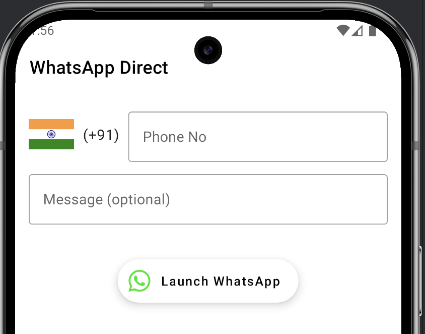
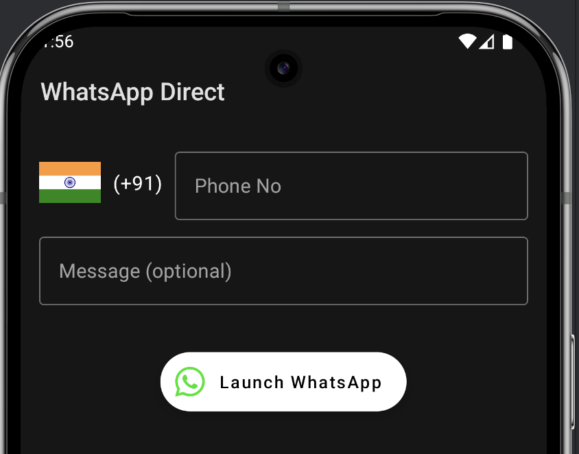
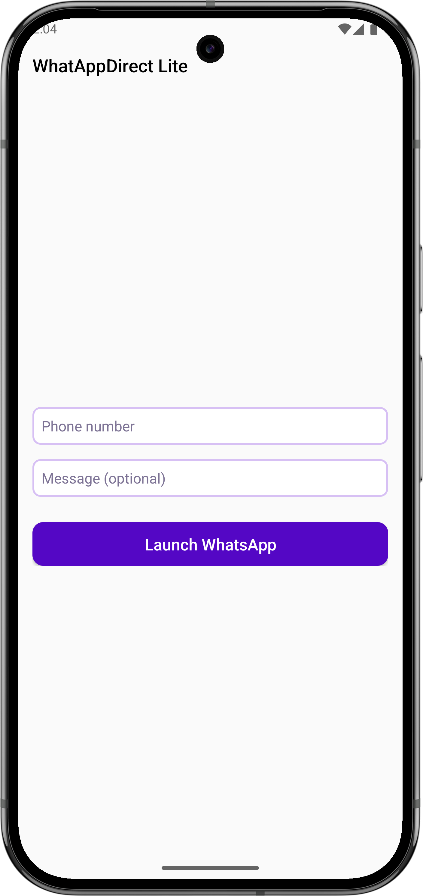
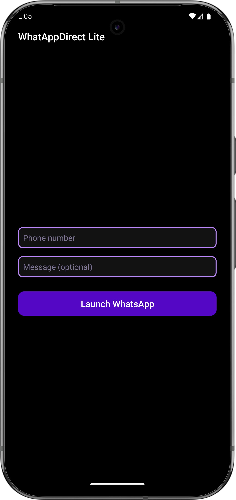

# WhatsApp Direct

## Overview

**WhatsApp Direct** is the Android app that allow you to directly send a message to a contact on
WhatsApp without saving their number. The app comes with two variants:

- **WhatsApp Direct** (More Polished UI)
- **WhatsApp Direct Lite** (Simplified version with minimal UI)

Both versions of the app provide easy access to send a message directly to any number without
needing to add the contact to your address book. Additionally, the app supports **long-press actions
** from text inputs to launch WhatsApp directly.

---

## Features

### WhatsApp Direct

- **Polished User Interface**: Offers a sleek and modern UI with enhanced animations and styling.
- **Send Direct Messages**: Send WhatsApp messages to any phone number without adding it to your
  contact list.
- **Recent Contacts**: Shows recently used phone numbers for easier access.
- **Fast & Reliable**: Optimized for quick message sending.

### WhatsApp Direct Lite

- **Minimal User Interface**: A simpler, lightweight UI with just the essentials to send messages
  quickly.
- **Direct Message Functionality**: Same as WhatsApp Direct, but with fewer features for those who
  prefer a lighter app experience.

### Common Features

- **Launch WhatsApp from Long Press**: You can long-press on any text input field (such as contacts,
  messages, or phone numbers) to launch WhatsApp and directly send a message.
- **Dark/Light Theme Support**: Seamlessly adapts to Android’s light and dark modes.
- **No Need to Save Contact**: Send messages to any number without saving them in your contact list.
- **Simple and Easy to Use**: Just enter the number and message and hit send.

---

## Screenshots

### WhatsApp Direct (More Polished UI)

| Light Theme                                                  | Dark Theme                                                 |
|--------------------------------------------------------------|------------------------------------------------------------|
|  |  |

### WhatsApp Direct Lite (Simplified UI)

| Light Theme                                                       | Dark Theme                                                      |
|-------------------------------------------------------------------|-----------------------------------------------------------------|
|  |  |

---

## How to Use

### **WhatsApp Direct App**:

1. **Launch the App**: Open the app from your app drawer.
2. **Enter Phone Number**: Type the phone number you wish to send a message to in the input field.
3. **Type Message**: Enter the message you want to send.
4. **Send Message**: Click the "Send" button to open WhatsApp and send the message directly.

### **WhatsApp Direct Lite App**:

1. **Launch the App**: Open the app.
2. **Enter Phone Number**: Type the phone number you want to send a message to.
3. **Send the Message**: Hit the "Send" button to open WhatsApp and send your message.

### **Using Long Press to Launch WhatsApp**:

- Long press on any **text input field** in your app (such as a text box where you input a phone
  number) to directly launch WhatsApp and send a message. This is particularly useful for quicker,
  repetitive tasks.

---

## Installation

You can install **WhatsApp Direct** or **WhatsApp Direct Lite** on your Android device using the
following steps.

### **From APK (Manual Installation)**:

1. Download the APK file from
   the [releases section](https://github.com/Devendra34/WhatsAppDirect/releases).
2. Enable **"Install from Unknown Sources"** on your Android device (Settings → Security → Unknown
   Sources).
3. Open the downloaded APK file to begin installation.

---

## Requirements

- **Android Version**: 7.0 (Nougat) and above.
- **WhatsApp** must be installed on the device to send messages.
- **Internet Connection**: Required to send messages via WhatsApp.

---
